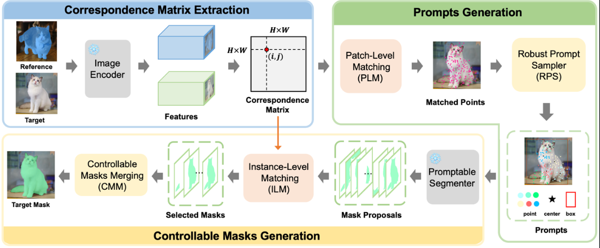

# One-Shot Instance Segmentation

Training-free instance segmentation system utilizing a single reference image and mask. The architecture employs two frozen pretrained models in a linear pipeline without fine-tuning or external repository dependencies.



| Stage | Model | Checkpoint | Output |
|-------|-------|------------|--------|
| Dense Feature Extraction | DINOv2 ViT-B/14 | `facebook/dinov2-base` | Patch tokens for reference and target images |
| Prompted Mask Generation | Segment Anything ViT-B | `facebook/sam-vit-base` | `predicted_mask` |

### Usage Example

```python
from pipeline.one_shot_segmentation import segment_object

result = segment_object(reference_image, reference_mask, target_image)
result.predicted_mask, result.candidate_region, result.similarity_map
result.confidence, result.runtime
```

### Implementation Status

- **Phase 1 (Pipeline Implementation)**: Complete and verified end-to-end on synthetic demo with actual checkpoints. Performance metrics on CPU: IoU 0.996, Dice 0.998, precision 1.000, recall 0.996 (15 seconds).
- **Phase 2 (Benchmark Evaluation)**: Implemented. Dataset comprises 100 reference/target pairs constructed from measured COCO 2017 validation annotations using category-level transfer without artificial transformations. Includes integrity validation, resumable execution, and baseline results on CPU: **IoU mean 0.274, median 0.073, 26% of pairs achieving IoU >= 0.5, 100% detection rate** (100 pairs, 80 categories, seed 0). The variance between mean and median metrics demonstrates that class-level transfer achieves varying success across different object categories.
- **Phase 3 (Robustness Evaluation)**: Pending. This phase will evaluate viewpoint, illumination, scale, and occlusion robustness under controlled transformations using the proposed method.

Design rationale, model selection justification, and limitations are documented in [docs/architecture.md](docs/architecture.md).

---

## Pipeline Overview

The system operates through a single function call:

```python
result = segment_object(reference_image, reference_mask, target_image)
```

The system requires one reference image with a mask defining the object, and a target image where the object should be segmented. The pipeline executes seven sequential steps using two frozen pretrained models without any training or fine-tuning:

| Step | Operation | Description | Module |
|------|-----------|-------------|--------|
| 1 | Feature Extraction | DINOv2 ViT-B/14 encodes both images into patch tokens (one token per 14x14 pixel cell). Using the same encoder ensures both token spaces are directly comparable. | `models/feature_encoder.py` |
| 2 | Reference Representation | The reference mask filters tokens to those covering the object; their mean creates a descriptor representing "this is what I was shown". | `matching/reference_representation.py` |
| 3 | Correspondence Mapping | Each target token is scored against the descriptor using cosine similarity, producing a similarity map over the target image. | `matching/correspondence.py` |
| 4 | Object Localization | The similarity map is processed, thresholded, and grouped into connected candidate regions, each converted to a bounding box with confidence score. | `matching/localization.py` |
| 5 | Candidate Selection | The highest-confidence candidate is selected. Rejected candidates remain in `result.candidates` for inspection. | `matching/localization.py` |
| 6 | Mask Generation | SAM (facebook/sam-vit-base) uses the selected box and center point to produce `result.predicted_mask`. | `models/segmenter.py` |
| 7 | Evaluation | Calculates IoU, Dice, precision, and recall against ground-truth masks. This step is for benchmarking only and does not affect pipeline operation. | `evaluation/metrics.py` |

Steps 1-6 constitute the application pipeline; step 7 provides evaluation metrics for benchmarking. Each pair evaluation produces seven visualization panels arranged left to right: reference image, reference mask, target image, similarity map, selected candidate, predicted mask, and prediction (red) overlaid on ground truth (green). Each panel displays corresponding metrics, confidence score, and category caption below it.

### Best Results

Out of 100 evaluated pairs, the pipeline demonstrates strong transfer capabilities on specific categories:

| Category | IoU | Visualization |
|----------|-----|---------------|
| dog | 0.962 |  |
| parking meter | 0.949 |  |
| toilet | 0.947 |  |

In these examples, the similarity map correctly identifies the target object, the candidate box properly encloses it, and SAM produces a mask that closely aligns with ground truth. These results were achieved with identical pipeline configuration, weights, and no category-specific tuning, demonstrating the effectiveness of the training-free approach.

Per-pair metrics, timings, and condition annotations are stored in `results/baseline/samples/` as individual JSON files. Aggregate run metrics are provided in [Phase 2 Benchmark Results](#the-phase-2-benchmark).

---

## Quick Start

### Google Colab Execution

1. Configure the runtime: `Runtime > Change runtime type > Hardware accelerator > GPU`
2. Open `notebooks/02_one_shot_pipeline.ipynb` in Colab
3. Execute all cells: `Runtime > Run all`

No repository cloning, archive extraction, or file uploads are required. The notebook embeds project modules and writes them to a temporary directory added to `sys.path`. Default execution uses the synthetic demo pair, producing results in approximately one minute on a clean runtime. Datasets are downloaded only when explicitly enabled via `DOWNLOAD_DATASETS = True`.

The notebook follows a structured workflow: Environment Setup, Dataset Configuration, Model Loading, Reference Image Loading, Target Image Loading, Feature Extraction, Correspondence Mapping, Object Localization, Mask Generation, Full Pipeline Execution, Visualization, Evaluation, and Result Export.

### Phase 2 Benchmark

Execute `notebooks/03_dataset_evaluation.ipynb` for benchmark evaluation. This notebook mounts Google Drive, locates the `data/` directory, validates pair integrity, loads the frozen pipeline, processes pairs with per-sample resumability, generates run-level figures, and exports results back to Drive. Set `OSB_LIMIT=1` before full execution to perform a single-pair smoke test.

---

## Repository Structure

```
.
├── configs/paths.yaml               # Configuration: paths, model IDs, stage defaults
├── docs/architecture.md             # Data flow, model selection rationale, limitations
├── docs/dataset_comparison.md       # Dataset evaluation with citations
├── docs/pairing_protocol.md         # Pair definition and constraints
├── models/
│   ├── feature_encoder.py           # Step 1: DINOv2 dense feature extraction
│   └── segmenter.py                 # Step 6: SAM with box and point prompts
├── matching/
│   ├── reference_representation.py  # Step 2: Masked reference token processing
│   ├── correspondence.py            # Steps 3-4: Target token correspondence and similarity
│   └── localization.py              # Step 5: Candidate generation, bounding boxes, confidence
├── pipeline/one_shot_segmentation.py# Step 7: segment_object function and OneShotResult class
├── evaluation/
│   ├── metrics.py                   # Step 9: IoU, Dice, precision, recall calculations
│   ├── cases.py                     # JSON manifest processing for datasets
│   ├── dataset_integrity.py         # Data validation gate
│   └── runtime.py                   # Random seeds, timing, provenance tracking
├── visualization/
│   ├── results.py                   # Step 8: Result panels and patch grid generation
│   └── benchmark.py                 # 7-panel visualization and run-level figures
├── tools/
│   ├── embed_sources.py             # Notebook generation and verification
│   ├── build_benchmark.py           # COCO pair and mask generation
│   ├── run_benchmark.py             # Resumable runner with CSV and summary output
│   ├── download_datasets.py         # Dataset acquisition utilities
│   ├── make_demo_pair.py            # Synthetic example generation
│   ├── smoke_test.py                # End-to-end testing with test doubles or real models
│   ├── run_notebook.py              # Headless notebook execution
│   ├── test_download_datasets.py    # Dataset layout validation tests
│   ├── test_notebook_bundle.py      # Notebook freshness verification
│   ├── test_dataset_integrity.py    # Mask decoding, pairing, and fault injection tests
│   └── test_benchmark_suite.py      # Aggregation, provenance, and figure generation tests
├── scripts/check_dataset.py         # Command-line integrity validation
├── notebooks/02_one_shot_pipeline.ipynb
└── notebooks/03_dataset_evaluation.ipynb
```

Directories `datasets/`, `checkpoints/`, `logs/`, and bulk content within `data/` and `results/` are git-ignored. Tracked content in `data/` includes pair manifests, metadata, and splits that define the benchmark precisely. Tracked content in `results/` includes the baseline CSV, summary statistics, provenance records, per-pair JSON files, and rendered figures displayed in this documentation. Raw images and annotations can be re-downloaded; figures can be re-generated from the stored records.

---

## Module Usage

### Installation

```bash
pip install "transformers>=4.40" accelerate safetensors
```

### Testing and Validation

```bash
python tools/smoke_test.py                    # End-to-end test with test doubles, no downloads
python tools/smoke_test.py --real --device cuda  # End-to-end test with real checkpoints
python tools/test_download_datasets.py        # Dataset layout logic validation
python tools/test_notebook_bundle.py         # Notebook freshness verification
python tools/test_dataset_integrity.py       # Mask decoding, pairing, fault injection tests
python tools/test_benchmark_suite.py         # Aggregation, provenance, figure generation tests
python tools/run_notebook.py                  # Headless notebook execution
python tools/embed_sources.py                 # Notebook regeneration
python tools/embed_sources.py --check         # Verification (exits with error if stale)
```

### Dataset Management

```bash
python tools/download_datasets.py --list
python tools/download_datasets.py --only coco20i pascal --val-only
python tools/download_datasets.py --verify
```

The smoke test executes the complete pipeline structure using color and gradient patch descriptors with a box-filling segmenter, validating all components including plumbing, mask pooling, correspondence calculations, metrics, and plotting without requiring network access or model checkpoints. Test doubles are explicitly labeled; only the `--real` flag loads pretrained models.

---

## Phase 2 Benchmark Implementation

### Benchmark Execution

```bash
# Step 1: Generate 100 pairs from COCO 2017 validation set
python tools/build_benchmark.py --root data --pairs 100 --seed 0

# Step 2: Data validation - system refuses to process invalid data
python scripts/check_dataset.py --root data

# Step 3: Evaluate pipeline with per-sample resume capability
python tools/run_benchmark.py --split all --output results/baseline --seed 0

# Step 4: Generate visualizations for top-performing pairs
python tools/run_benchmark.py --split all --output results/baseline --figures 10
```

### Benchmark Specifications

The pair construction methodology, evaluation conditions, and constraints are detailed in [docs/pairing_protocol.md](docs/pairing_protocol.md). Dataset selection rationale, including citations and measured download bandwidths, is provided in [docs/dataset_comparison.md](docs/dataset_comparison.md). Key parameters include:

- **Pair Composition**: 100 pairs spanning 80 categories, one pair per object instance. Reference and target images are distinct samples from the same category. Category-level identity is used rather than same-instance matching, as COCO lacks instance-level video sequences.
- **Evaluation Conditions**: No synthetic transformations for viewpoint, illumination, scale, occlusion, noise, or blur are applied. The `scale_condition` attribute (`similar`, `smaller_in_target`, `larger_in_target`) is calculated from mask area ratios. Other condition attributes (`viewpoint_condition`, `illumination_condition`, `occlusion_condition`) are marked as `unknown` since the dataset does not provide this information.
- **Validation Requirements**: `scripts/check_dataset.py` must return `RESULT: PASS` before benchmark execution. `tools/run_benchmark.py` performs independent validation and aborts on failure.
- **Result Reproducibility**: Each run generates `results.csv`, `summary.json`, `provenance.json` (containing seed, device, package versions, model identifiers, and dataset identity), and individual JSON records for each pair, enabling complete result traceability.

### Baseline Performance Results

**Evaluation Environment**: CPU, seed 0, 100 pairs (`results/baseline/`)

| Metric | Value |
|--------|-------|
| IoU mean / median / standard deviation | 0.274 / 0.073 / 0.334 |
| IoU quartiles (25th, 75th percentile) | 0.000, 0.506 (maximum 0.962) |
| Pair success rates at IoU >= 0.5 / 0.7 / 0.9 | 26% / 18% / 10% |
| Object detection rate | 100% |
| Performance by scale condition (mean / median, count) | `larger_in_target` 0.322 / 0.298 (31 pairs) · `similar` 0.322 / 0.057 (35 pairs) · `smaller_in_target` 0.182 / 0.002 (34 pairs) |

| IoU Distribution | Category-Level IoU |
|------------------|-------------------|
|  |  |

The substantial difference between mean and median IoU values reflects the performance characteristics of the baseline approach: the pipeline achieves strong transfer on certain object categories while performing poorly on others. Statistical analysis reveals that 19 of 80 categories achieve 0.0 IoU across all pairs, 36 categories never exceed 0.1 IoU, and 59 of 100 pairs fall below 0.25 IoU. Category counts should be considered when interpreting results, as most categories in the 100-pair, 80-category dataset contain only one or two pairs. These baseline metrics provide the performance threshold that subsequent robustness methods must surpass.

---

## Supported Datasets

### Dataset Acquisition

```python
from tools.download_datasets import download_all, print_layout_table

download_all("datasets", val_only=True, stage="images")
print_layout_table("datasets")
```

### Available Datasets

| Dataset | Images | Few-Shot Masks |
|---------|--------|----------------|
| COCO-20i | `val2014` with official annotations (HTTP) | Google Drive |
| FSS-1000 | Google Drive | Google Drive |
| LVIS-92i | COCO 2017 (HTTP, shared with PACO) | Google Drive |
| PACO-Part | COCO 2017 (HTTP, shared) | Google Drive |
| Pascal-Part | VOC 2010 with parts annotations (HTTP) | Google Drive |

### Configuration

Mask archives hosted on Google Drive are skipped until file IDs are configured in `tools/drive_ids.json` (alternatively via `--drive-ids key=value` or environment variable `GDRIVE_IDS`). Directory structure is created regardless, and `--verify` reports missing components.

The system reads dataset paths from a `data/cases.json` manifest, avoiding dataset-specific split format assumptions:

```json
{"root": "datasets",
 "cases": [{"name": "coco-20i-val-1",
            "reference_image": "COCO2014/val2014/COCO_val2014_000000391895.jpg",
            "reference_mask": "COCO2014/annotations/val2014/000000391895.png",
            "target_image": "COCO2014/val2014/COCO_val2014_000000000139.jpg",
            "target_mask": "COCO2014/annotations/val2014/000000000139.png"}]}
```

---

## Notebook Management

### Generated Notebooks

`notebooks/02_one_shot_pipeline.ipynb` contains the eleven Phase 1 modules; `notebooks/03_dataset_evaluation.ipynb` contains the fourteen Phase 1 and Phase 2 modules. Both notebooks include embedded module fingerprints for verification. After modifying source code, regenerate notebooks using:

```bash
python tools/embed_sources.py
python tools/embed_sources.py --check    # Exits with error code if any notebook is stale
```

### Source Revision Tracking

Each embedded module includes a `NOTEBOOK_SOURCE_REVISION` marker. Immediately following each source cell, a verification cell compares in-memory modules against the recorded revision. This mechanism detects a common notebook execution issue: re-executing a source cell rewrites files but does not reload already-imported Python modules, causing sessions to execute outdated code while tracebacks reference line numbers from different file versions. The verification identifies mismatched modules and prompts for runtime restart. The test suite `python tools/test_notebook_bundle.py` validates this behavior offline.

---

## System Requirements

- **Python**: Version 3.10 or higher
- **Dependencies**: `torch`, `transformers>=4.40`, NumPy, SciPy, Matplotlib, Pillow
- **Platform**: Google Colab includes all required dependencies; only `transformers` requires installation
- **Hardware**: GPU runtime recommended for optimal performance (DINOv2-base and SAM ViT-B require 8 GB GPU memory). CPU execution is supported (demonstrated demo run: 15 seconds)
- **Storage**: Approximately 750 MB for model checkpoint downloads on initial run
- **Dataset Storage**: Approximately 40 GB for all five datasets combined (COCO images). Use `--val-only` flag during development iterations
- **Phase 2 Benchmark Storage**: Minimal requirements - `tools/build_benchmark.py` retains only necessary COCO images (~40 MB) and the 19 MB annotation file. Processing time is approximately 25-30 seconds per pair on CPU (full baseline: ~40 minutes). Resume functionality enables cost-free re-execution. `--limit` and `OSB_LIMIT` options reduce smoke tests to single-pair validation.
