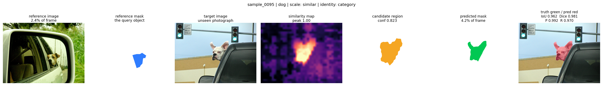
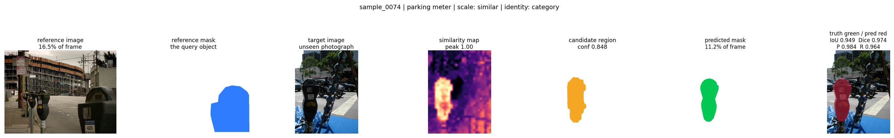
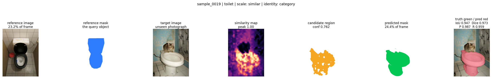
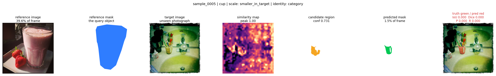
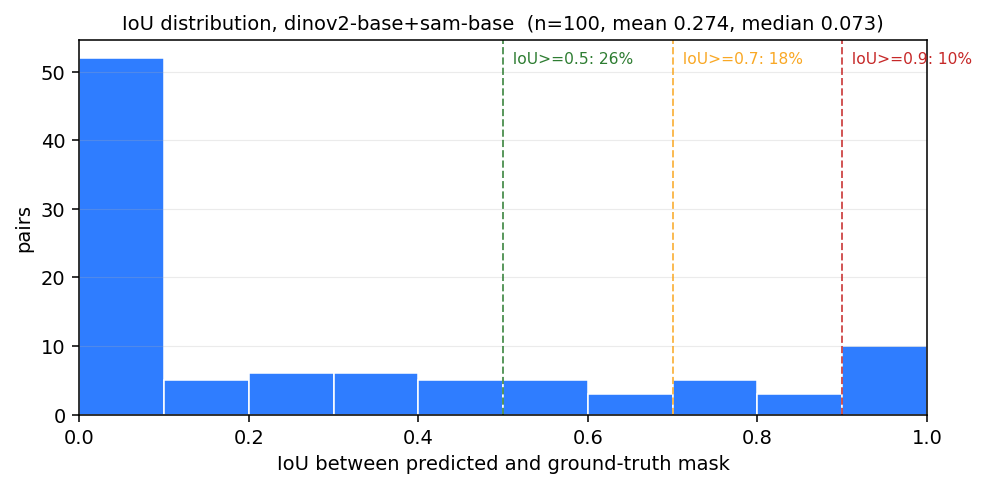
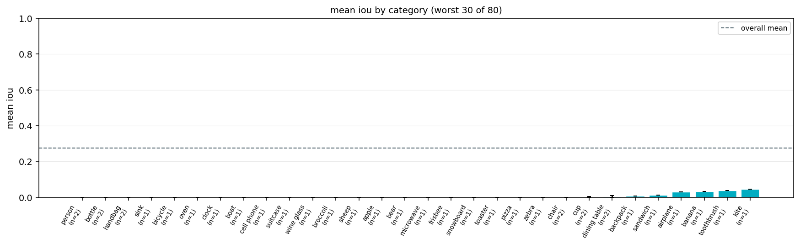

# One-Shot Instance Segmentation

Training-free instance segmentation from a single reference image and mask. Two
frozen pretrained models, one linear pipeline, no fine-tuning, no external
repository:

| stage | model | checkpoint | output |
| --- | --- | --- | --- |
| dense features | DINOv2 ViT-B/14 | `facebook/dinov2-base` | patch tokens for both images |
| prompted mask | Segment Anything ViT-B | `facebook/sam-vit-base` | `predicted_mask` |

```python
from pipeline.one_shot_segmentation import segment_object

result = segment_object(reference_image, reference_mask, target_image)
result.predicted_mask, result.candidate_region, result.similarity_map
result.confidence, result.runtime
```

> **Status**
>
> * **Phase 1 - the pipeline: implemented and verified** end to end on the
>   synthetic demo pair with the real checkpoints: IoU 0.996, Dice 0.998,
>   precision 1.000, recall 0.996 on CPU in 15 s.
> * **Phase 2 - the benchmark: implemented.** 100 reference/target pairs built
>   from measured COCO 2017 val annotations (category-level transfer, no
>   artificial transforms), an integrity gate that must pass before anything
>   runs, a resumable runner, and this baseline result on CPU:
>   **IoU mean 0.274, median 0.073, 26% of pairs at IoU >= 0.5, 100% found**
>   (100 pairs, 80 categories, seed 0). The gap between the mean and the median
>   is the finding: class-level transfer works for some categories and fails
>   outright for others.
> * Phase 3 (viewpoint, illumination, scale and occlusion robustness under
>   controlled transforms; the proposed method) has not been started.

Design, model rationale and limitations: **[docs/architecture.md](docs/architecture.md)**.

---

## How the application works

The application is one call:

```python
result = segment_object(reference_image, reference_mask, target_image)
```

Give it one image where the object is drawn as a mask, and a second image in
which you want that object, and it returns a mask for it in the second image.
Seven steps, two frozen models, no training, no fine-tuning:

| # | step | what happens | module |
| --- | --- | --- | --- |
| 1 | features | DINOv2 ViT-B/14 encodes **both** images into patch tokens (one token per 14x14 px cell). Same encoder, so the two token spaces are directly comparable. | `models/feature_encoder.py` |
| 2 | reference | the reference mask keeps only the tokens that cover the object; their mean is one descriptor meaning *"this is what I was shown"*. | `matching/reference_representation.py` |
| 3 | correspondence | every target token is scored against that descriptor with a cosine similarity → a similarity map over the target image. | `matching/correspondence.py` |
| 4 | localization | the map is cleaned, thresholded and grouped into connected candidate regions; each becomes a box with a confidence. | `matching/localization.py` |
| 5 | selection | the highest-confidence candidate wins. The rejected ones stay in `result.candidates`, so a wrong pick is inspectable rather than hidden. | `matching/localization.py` |
| 6 | segmentation | SAM (`facebook/sam-vit-base`) is prompted with the chosen box plus its centre point and returns `result.predicted_mask`. | `models/segmenter.py` |
| 7 | evaluation | IoU, Dice, precision and recall against the ground-truth mask. Evaluation only - the pipeline itself never sees it. | `evaluation/metrics.py` |

Steps 1-6 are the application; step 7 is what the benchmark measures. The seven
panels below are what the benchmark records for a single pair, left to right:
**reference image, its mask, target image, similarity map, chosen candidate,
predicted mask, prediction (red) over ground truth (green)**. Underneath each
panel figure are the metrics, the confidence and the caption with the category.

### Where it works: the three best pairs of the run

Out of 100 pairs, the pipeline transfers almost perfectly on some categories.
`dog`, IoU **0.962**:



`parking meter`, IoU **0.949** - a thin, rigid, visually distinctive object,
exactly the shape the similarity map localises cleanly:



`toilet`, IoU **0.947**:



In all three the similarity map lights up on the right object, the candidate
box contains it, and SAM's mask follows the ground truth closely. The same
pipeline, same weights and no per-category tuning produced these - that is the
point of a training-free baseline.

### Where it fails: the same seven panels on a zero-IoU pair

`cup`, IoU **0.000**, confidence 0.731:



`couch`, IoU **0.000**, confidence 0.773:


Read the panels against the successes above: the reference descriptor is
clean, but on the target image the similarity peaks land on a different object
or smear across the background, the chosen candidate is confident anyway, and
SAM faithfully segments the *wrong* region. **Confidence measures where the
candidate is, not whether it is the right object** - a mean IoU of 0.274 with
26% of pairs at IoU >= 0.5 is what class-level transfer buys without any
robustness method on top, and it is the number a proposed method has to beat.

Every pair's numbers, timings and condition columns are one JSON file per pair
in `results/baseline/samples/`; the run-level numbers are next in
[The Phase 2 benchmark](#the-phase-2-benchmark).

---

## Quick start (Google Colab)

1. `Runtime > Change runtime type > Hardware accelerator > GPU`.
2. Open `notebooks/02_one_shot_pipeline.ipynb` in Colab.
3. `Runtime > Run all`.

Nothing needs to be cloned, unzipped or uploaded: the notebook embeds the project
modules and writes them to a scratch directory on `sys.path`. It runs on the
synthetic demo pair by default, so a clean runtime produces a result in about a
minute. Datasets are never downloaded unless you set `DOWNLOAD_DATASETS = True`.

The notebook follows the same order as the code: Environment, Datasets, Load
models, Load reference, Load target, Extract features, Correspondence,
Localization, Segmentation, Full pipeline, Visualize, Evaluate, Save result.

**The Phase 2 benchmark** is `notebooks/03_dataset_evaluation.ipynb`, in the
same style: it mounts Drive, locates `data/`, refuses to run against damaged
pairs, loads the same frozen pipeline, runs the pairs with per-sample resume,
draws the run figures, the worst-pair panels and the best-pair panels (all of
them also saved into `results/baseline/figures/`), and copies the results back
to Drive. `OSB_LIMIT=1` before *Run all* smoke-tests the whole path on one pair.

---

## Repository layout

```
.
├── configs/paths.yaml               # paths, model ids, stage defaults
├── docs/architecture.md             # data flow, model choice, limitations
├── docs/dataset_comparison.md       # datasets considered, with citations
├── docs/pairing_protocol.md         # what a pair is, and what it must not be
├── models/
│   ├── feature_encoder.py           # step 1  DINOv2 dense features
│   └── segmenter.py                 # step 6  SAM with box + point prompts
├── matching/
│   ├── reference_representation.py  # step 2  masked reference tokens
│   ├── correspondence.py            # steps 3-4  target tokens, similarity
│   └── localization.py              # step 5  candidates, boxes, confidence
├── pipeline/one_shot_segmentation.py# step 7  segment_object, OneShotResult
├── evaluation/
│   ├── metrics.py                   # step 9  IoU, Dice, P, R + run aggregation
│   ├── cases.py                     # JSON-manifest cases for a dataset
│   ├── dataset_integrity.py         # the gate every pair must pass
│   └── runtime.py                   # seeds, timings, provenance
├── visualization/
│   ├── results.py                   # step 8  result panels, patch grid
│   └── benchmark.py                 # 7-panel pair figure, run-level figures
├── tools/
│   ├── embed_sources.py             # generates + verifies both notebooks
│   ├── build_benchmark.py           # COCO pairs, masks, splits
│   ├── run_benchmark.py             # resumable runner -> CSV, summary, provenance
│   ├── download_datasets.py         # COCO-20i, FSS-1000, LVIS, PACO, Pascal-Part
│   ├── make_demo_pair.py            # deterministic synthetic example
│   ├── smoke_test.py                # end-to-end test, stubs or real models
│   ├── run_notebook.py              # headless run of either notebook
│   ├── test_download_datasets.py    # offline test of the dataset layout
│   ├── test_notebook_bundle.py      # notebook freshness + stale-session guard
│   ├── test_dataset_integrity.py    # decoders, pairing, splits, fault injection
│   └── test_benchmark_suite.py      # aggregation, provenance, figures, runner
├── scripts/check_dataset.py         # integrity gate from the terminal
├── notebooks/02_one_shot_pipeline.ipynb
└── notebooks/03_dataset_evaluation.ipynb
```

`datasets/`, `checkpoints/`, `logs/` and everything bulky underneath `data/` and
`results/` are git-ignored: the tracked part of `data/` is the pair manifests,
metadata and splits that fix the benchmark exactly, and the tracked part of
`results/` is the baseline CSV, summary, provenance, the per-pair JSON records
and the rendered figures this README shows. Raw images and annotations are
re-downloadable; the figures are re-renderable from those records.

---

## Using the modules directly

```bash
pip install "transformers>=4.40" accelerate safetensors

python tools/smoke_test.py                    # end-to-end, test doubles, no downloads
python tools/smoke_test.py --real --device cuda  # end-to-end, real checkpoints
python tools/test_download_datasets.py        # dataset layout logic, offline
python tools/test_notebook_bundle.py         # freshness guard for both notebooks
python tools/test_dataset_integrity.py       # mask decoding, pairing, fault injection
python tools/test_benchmark_suite.py         # aggregation, provenance, figures, runner
python tools/run_notebook.py                  # run either notebook in order, headless
python tools/embed_sources.py                 # regenerate both notebooks
python tools/embed_sources.py --check         # fail if a notebook is stale

python tools/download_datasets.py --list
python tools/download_datasets.py --only coco20i pascal --val-only
python tools/download_datasets.py --verify
```

`tools/smoke_test.py` runs the real pipeline shape against a colour-and-gradient
patch descriptor and a box-filling segmenter, so the plumbing, the mask pooling,
the correspondence maths, the metrics and the plots are all verified on a laptop
with no network and no checkpoints. The stubs are labelled as stubs; only
`--real` exercises the pretrained models.

---

## The Phase 2 benchmark

```bash
# 1. build 100 pairs from COCO 2017 val (annotations fetched over HTTP Range)
python tools/build_benchmark.py --root data --pairs 100 --seed 0

# 2. the gate - nothing runs against damaged data
python scripts/check_dataset.py --root data

# 3. score the frozen pipeline; per-sample resume, so a rerun costs nothing
python tools/run_benchmark.py --split all --output results/baseline --seed 0

# 4. render the worst pairs as well (7 panels each)
python tools/run_benchmark.py --split all --output results/baseline --figures 10
```

The pair set, the conditions and the prohibitions are written down in
[docs/pairing_protocol.md](docs/pairing_protocol.md); the datasets that were
considered and rejected, with citations and measured download bandwidths, are in
[docs/dataset_comparison.md](docs/dataset_comparison.md). In short:

* 100 pairs, 80 categories, one pair per object, reference and target always
  different images of the same category. **Identity is `category`**, not
  `same-object` - COCO has no instance video, and pretending otherwise would
  fake the very robustness this phase is meant to measure.
* No artificial viewpoint, illumination, scale, occlusion, noise or blur
  transformations. The only condition column that is *measured* is
  `scale_condition` (`similar` / `smaller_in_target` / `larger_in_target`, from
  the mask area ratio); `viewpoint_condition`, `illumination_condition` and
  `occlusion_condition` are `unknown` because the dataset does not say.
* `scripts/check_dataset.py` must report `RESULT: PASS` before a run starts;
  `tools/run_benchmark.py` re-runs it and refuses otherwise.
* Every run writes `results.csv`, `summary.json`, `provenance.json` (seed,
  device, package versions, model ids, dataset identity) and one JSON record per
  pair, so any figure can be traced back to what produced it.

**Baseline, CPU, seed 0, 100 pairs** (`results/baseline/`):

| metric | value |
| --- | --- |
| IoU mean / median / std | 0.274 / 0.073 / 0.334 |
| IoU quartiles (q25, q75) | 0.000, 0.506 (max 0.962) |
| pairs at IoU >= 0.5 / 0.7 / 0.9 | 26% / 18% / 10% |
| object found | 100% |
| by scale (`mean` / `median`, n) | `larger_in_target` 0.322 / 0.298 (31) · `similar` 0.322 / 0.057 (35) · `smaller_in_target` 0.182 / 0.002 (34) |

| IoU across the 100 pairs | mean IoU per category |
| --- | --- |
|  |  |

The mean and the median disagreeing this hard is the result, not a bug: the
frozen pipeline transfers well on some pairs and fails outright on many others.
19 of the 80 categories score 0.0 on every pair they have, 36 categories never
reach IoU 0.1 on any of their pairs, and 59 of the 100 pairs sit below IoU 0.25.
Read every group with its `count`: over 100 pairs and 80 categories most
categories carry only one or two pairs, and `summary.json` keeps the count next
to each group for exactly that reason. A class-level baseline is what a
robustness method has to beat.

---

## Datasets

```python
from tools.download_datasets import download_all, print_layout_table

download_all("datasets", val_only=True, stage="images")
print_layout_table("datasets")
```

| dataset | images | few-shot masks |
| --- | --- | --- |
| COCO-20i | `val2014` + official annotations (HTTP) | Google Drive |
| FSS-1000 | Google Drive | Google Drive |
| LVIS-92i | COCO 2017 (HTTP, shared with PACO) | Google Drive |
| PACO-Part | COCO 2017 (HTTP, shared) | Google Drive |
| Pascal-Part | VOC 2010 + parts (HTTP) | Google Drive |

The mask archives are on Google Drive, so they are **skipped** until you add their
file ids to `tools/drive_ids.json` (or pass `--drive-ids key=value`, or set
`GDRIVE_IDS`). The layout is created either way and `--verify` reports exactly
what is still missing. `evaluation/cases.py` reads a `data/cases.json` manifest of
paths, so no dataset-specific split format is assumed:

```json
{"root": "datasets",
 "cases": [{"name": "coco-20i-val-1",
            "reference_image": "COCO2014/val2014/COCO_val2014_000000391895.jpg",
            "reference_mask": "COCO2014/annotations/val2014/000000391895.png",
            "target_image": "COCO2014/val2014/COCO_val2014_000000000139.jpg",
            "target_mask": "COCO2014/annotations/val2014/000000000139.png"}]}
```

---

## The notebooks are generated, and stay honest

`notebooks/02_one_shot_pipeline.ipynb` embeds the eleven Phase 1 modules;
`notebooks/03_dataset_evaluation.ipynb` embeds the fourteen Phase 1 and Phase 2
modules. Both print a fingerprint of what they embed. Regenerate them after any
source change:

```
python tools/embed_sources.py
python tools/embed_sources.py --check    # --check exits 1 when either is stale
```

Each embedded module also carries a `NOTEBOOK_SOURCE_REVISION` marker, and the
cell right after the source cell compares the modules in memory against it. This
catches the one confusing failure mode of a generated notebook: re-running the
source cell rewrites the files but does not reload what Python already imported,
so a session keeps executing the previous code and a traceback quotes line
numbers from two different versions of the same file. The check names the
mismatched modules and tells you to restart the runtime; `python
tools/test_notebook_bundle.py` asserts that behaviour offline.

---

## Requirements

* Python 3.10+, `torch`, `transformers>=4.40`, NumPy, SciPy, Matplotlib, Pillow.
  Colab ships all of these; only `transformers` is installed by the notebook.
* A GPU runtime for comfortable speed (DINOv2-base plus SAM ViT-B fit in 8 GB).
  The pipeline also runs on CPU - the verified demo run took 15 s.
* ~750 MB of checkpoint downloads on first run.
* A few GB per dataset; all five together are ~40 GB of COCO images, so use
  `--val-only` while iterating.
* The Phase 2 benchmark is much smaller: `tools/build_benchmark.py` keeps the
  COCO images its 100 pairs actually need (~40 MB) plus the 19 MB annotation
  file. A pair costs ~25-30 s on CPU, so the full baseline is ~40 minutes;
  resume makes a rerun free, and `--limit` / `OSB_LIMIT` cut a smoke test down
  to one pair.
